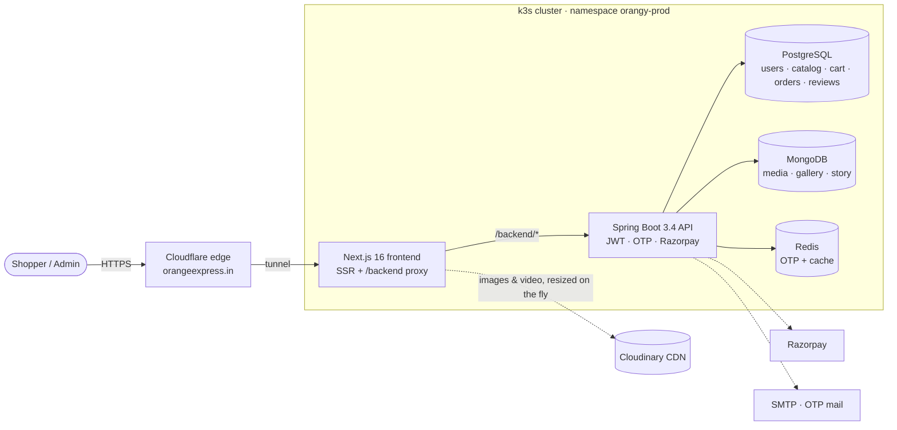
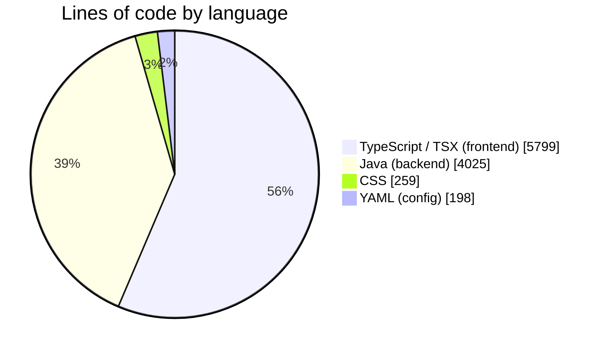
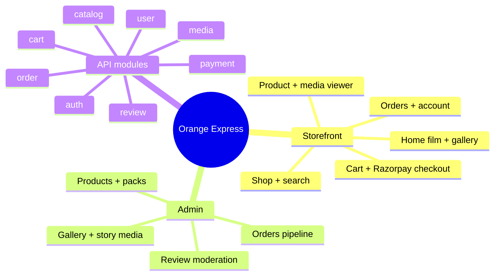
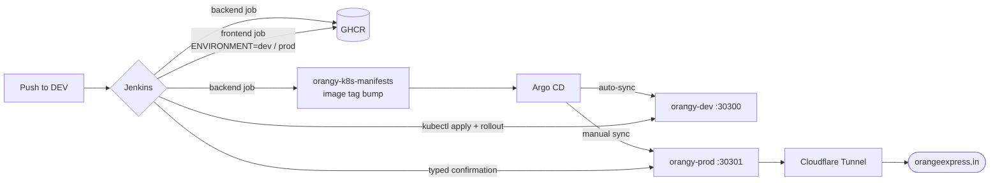

<div align="center">

# 🍊 Orange Express

**Farmer-owned oranges and cold-pressed juice, from our family groves in Pandhurna to your table.**

[](https://orangeexpress.in)


</div>

---

## Contents

- [What it is](#what-it-is)
- [Features](#features)
- [Architecture](#architecture)
- [Tech stack](#tech-stack)
- [Codebase at a glance](#codebase-at-a-glance)
- [Project structure](#project-structure)
- [Run it locally](#run-it-locally)
- [API overview](#api-overview)
- [Deployment](#deployment)
- [Roadmap](#roadmap)

## What it is

Orange Express is a direct-to-consumer storefront for a family orange orchard. Shoppers browse the harvest, pick a pack, pay with Razorpay and track their order. The orchard team runs everything — products, packs, stock, the photo and video gallery, the story section, reviews and orders — from a built-in admin dashboard.

The homepage opens with a scroll-choreographed **3D diorama** (three.js + GSAP), and the shop is built mobile-first in the style of India's quick-commerce apps: bold cards, a sticky buy bar, a bottom tab bar, and a Flipkart-style zoomable media viewer.

## Features

| For shoppers | For the orchard team |
| --- | --- |
| 🔐 Passwordless login with email OTP and JWT refresh | 📦 Product, pack (variant) and stock management |
| 🛍️ Shop with search, sort, category chips and price filters | 🖼️ Direct-to-Cloudinary photo and video uploads with progress |
| 🔍 Hover-to-magnify product photos and a full-screen viewer with pinch, wheel and double-tap zoom | 🎞️ Curated homepage gallery and "Our Story" carousel |
| 🎬 Homepage gallery that opens photos in a viewer and videos in a player | ⭐ Review moderation (approve / reject) |
| 🧺 Basket with one-tap +/− steppers and a sticky mobile buy bar | 🚚 Order pipeline: created → paid → packed → shipped → delivered |
| 💳 Razorpay checkout with saved addresses and first-order offer | 🌱 Featured products and farm-source details |
| 🌗 Light and dark themes, reduced-motion support, skip link | 📊 Swagger UI for every endpoint |

## Architecture



The browser only ever talks to the Next.js server. It proxies `/backend/*` to the API inside the cluster, so the API has no public route and needs no CORS. Media binaries live on Cloudinary; the API stores only their URLs, and the storefront requests resized AVIF/WebP versions (`f_auto,q_auto,w_…`) instead of camera-size originals.

## Tech stack

| Layer | Choice | Why |
| --- | --- | --- |
| Frontend | Next.js 16 App Router, React 19, TypeScript | Standalone server output for a small Docker image |
| Styling | Tailwind CSS 4 with CSS-variable design tokens | One token file drives light and dark themes |
| Data | TanStack Query | Caching, retries and optimistic cart updates |
| Motion | GSAP ScrollTrigger, Lenis, three.js | The scroll-driven 3D hero |
| Backend | Spring Boot 3.4, Java 17, Spring Security, JPA | Modular packages per domain |
| Storage | PostgreSQL, MongoDB, Redis | Relational orders, flexible media docs, fast OTP |
| Payments | Razorpay | UPI, cards and netbanking for India |
| Infra | k3s on Oracle Cloud (ARM64), Kustomize, Argo CD, Jenkins, GHCR, Cloudflare Tunnel | GitOps on a single low-cost node |

## Codebase at a glance





## Project structure

```text
Orangy/
├── frontend/                  Next.js storefront + admin
│   ├── app/                   routes: /, (store)/products, cart, checkout, orders, account, admin/*
│   ├── components/
│   │   ├── film/              3D scroll hero (ExpressFilm)
│   │   ├── media/             MediaViewer: zoom, pinch, swipe, video
│   │   ├── product/           ProductCard, ProductGallery (hover magnifier), offers
│   │   ├── sections/          homepage sections incl. bento Gallery
│   │   ├── navigation/        Navbar, mobile BottomNav
│   │   └── ui/                design-system primitives
│   ├── lib/                   api client, Cloudinary upload + delivery helpers, types
│   └── Jenkinsfile            build image → kubectl apply → rollout
├── orangy-backend/            Spring Boot API
│   └── src/main/java/com/orangy/{auth,catalog,cart,order,payment,review,media,user,config,common}
├── argocd-apps/               Argo CD Application definitions (dev auto-sync, prod manual)
├── Jenkinsfile                backend pipeline → GHCR → manifests repo
├── backend_api_full_documentation.md
└── Orangy_Postman_Collection.json
```

Kubernetes manifests live in [orangy-k8s-manifests](https://github.com/vedantkhursange/orangy-k8s-manifests) (Kustomize `base/` + `overlays/dev` and `overlays/prod`).

## Run it locally

**Backend** (needs Docker for the databases):

```bash
cd orangy-backend
docker compose up -d            # PostgreSQL, MongoDB, Redis
mvn spring-boot:run             # http://localhost:8080 · Swagger at /swagger-ui.html
```

**Frontend:**

```bash
cd frontend
cp .env.local.example .env.local   # Cloudinary cloud name + unsigned preset
npm ci
BACKEND_URL=http://localhost:8080 npm run dev   # http://localhost:3000
```

| Variable | Where | Purpose |
| --- | --- | --- |
| `BACKEND_URL` | frontend (runtime) | Where `/backend/*` is proxied |
| `NEXT_PUBLIC_CLOUDINARY_CLOUD_NAME`, `NEXT_PUBLIC_CLOUDINARY_UPLOAD_PRESET` | frontend (build) | Admin direct uploads |
| `JWT_SECRET`, `RAZORPAY_KEY_ID`, `RAZORPAY_KEY_SECRET`, `MAIL_USERNAME`, `MAIL_PASSWORD` | backend | Supplied from the `orangy-secrets` Kubernetes Secret, never committed |

## API overview

All responses are wrapped as `{ success, data, error }`. Full reference: [backend_api_full_documentation.md](backend_api_full_documentation.md) and the [Postman collection](Orangy_Postman_Collection.json).

| Area | Endpoints |
| --- | --- |
| Auth | `POST /api/auth/signup` · `login` · `verify-otp` · `resend-otp` · `refresh` · `GET /api/auth/me` |
| Catalogue | `GET /api/products` (category, price, paging) · `/featured` · `/{id}` · `/{id}/variants` |
| Cart | `GET /api/cart` · `POST /items` · `PUT/DELETE /items/{variantId}` |
| Orders | `POST /api/orders` · `verify-payment` · `payment-failed` · `GET /{orderId}` |
| Reviews | `POST /api/reviews` · `GET /product/{productId}` · `GET /my-reviews` |
| Media | `GET /api/media/gallery` · `/story` · `/product/{productId}` · `/hero-video` |
| Admin | `/api/admin/products` · `/orders` · `/reviews` · `/media` |

## Deployment



- **Branches:** day-to-day work lands on `DEV`; `main` mirrors what runs in production.
- **Dev first:** every UI change is deployed to the dev namespace and checked there before a production release.
- **Prod gate:** the frontend job asks for the exact text `DEPLOY-PROD-FRONTEND` before it touches production; Argo CD syncs the prod backend only on a manual click.
- **Backups:** a nightly CronJob in prod dumps PostgreSQL and MongoDB.

## Roadmap

- [x] Responsive Swiggy-style storefront refresh with brand and action colour tokens
- [x] Flipkart-style product zoom and a shared photo/video viewer
- [x] Cloudinary on-the-fly resizing (product page from ~15 MB to well under 1 MB)
- [ ] Server-rendered product pages with Product structured data for SEO
- [ ] Git-SHA image tags for the frontend so Argo CD can roll back
- [ ] Playwright smoke and screenshot tests in Jenkins before every prod release
- [ ] Server-side product search and sort

<div align="center">

Made with 🍊 in Pandhurna, India.

</div>
